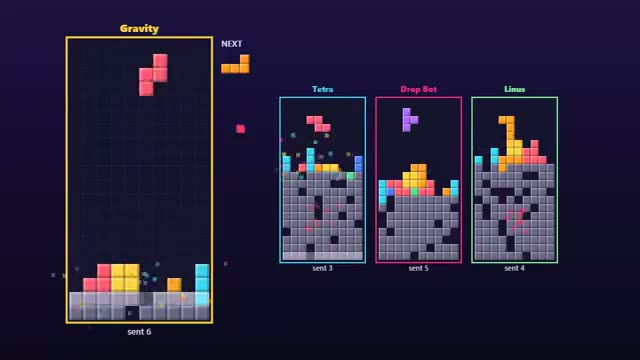

# Block Drop Battle

Clear lines to send junk to your rival. A multiplayer starter game from [Multiplayer Agent](https://multiplayeragent.com): 2D, versus, 2–4 players, with bots that fill empty seats.

## How it plays

Falling blocks, like the classic. Clear two or more lines at once and a rival gets junk rows at the bottom. Last board standing wins.

**Controls:** Arrow keys and Space, or tap to rotate, swipe to move, swipe down to drop.

## Make it yours in the Game Builder

Open the [Game Builder](https://multiplayeragent.com), choose **Start from a starter game** and pick Block Drop Battle. It opens as version 1 in your studio, ready to play and publish. Then ask for changes, for example:

- Add a hold slot
- Make it four players who pick a target
- Add a 2-minute sprint mode

## Run it yourself

1. Get a free publishable key (`pk_…`) at [multiplayeragent.com](https://multiplayeragent.com).
2. In `index.html`, put it in place of `pk_REPLACE_ME` in the `MP_CONNECT` block.
3. Open `index.html` in a browser. No build step and no server needed.

Without a key it still runs, offline against bots.

## How it is built

- One `index.html`. The comment at the top of the script maps the code and explains the multiplayer.
- **Live sync:** You see every rival's board move as they play.
- **Host-run rounds:** The host's browser runs the match: who is out, the winner and the restart. If it leaves, the next player takes over.
- **Bots:** Bots fill empty seats and stack and clear lines like a decent player.
- **Leaderboard:** The most lines each player sent in one match.
- `?attract` runs it offline with bots only. The preview video is recorded from it.

## License

MIT.
